# Small Office Network Troubleshooting Lab

## Project Overview

This hands-on Cisco Packet Tracer project demonstrates the design, configuration, testing, and troubleshooting of a small office network.

The environment consists of two separate IPv4 subnets connected by a Cisco router. The project includes three simulated IT support incidents, each demonstrating a structured troubleshooting process: identifying a connectivity problem, examining network settings, applying corrective actions, and verifying restored communication.

**Tools and Technologies**
- Cisco Packet Tracer
- Cisco router and switches
- IPv4 addressing and subnetting
- TCP/IP networking
- Inter-subnet routing
- ICMP connectivity testing
- Command-line diagnostics (`ping`, `ipconfig /all`)

## Network Topology

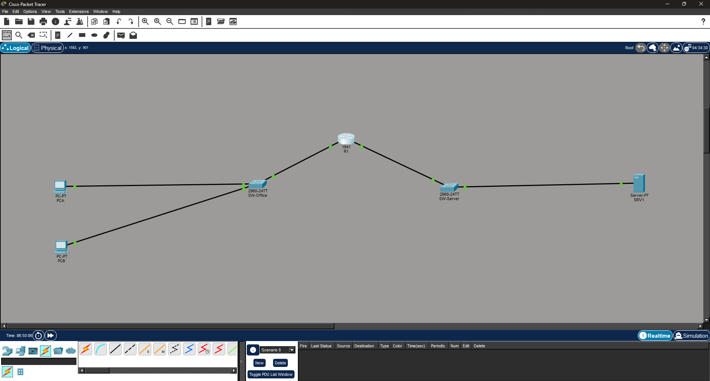

**Network Devices**
- 1 Cisco router (R1)
- 2 switches (SW-Office and SW-Server)
- 2 workstations (PC-A and PC-B)
- 1 server (SRV1)

### IP Addressing Scheme

| Device | IP Address | Subnet Mask | Default Gateway |
|---|---|---|---|
| R1 - Office Interface | 192.168.10.1 | 255.255.255.0 | N/A |
| R1 - Server Interface | 192.168.20.1 | 255.255.255.0 | N/A |
| PC-A | 192.168.10.10 | 255.255.255.0 | 192.168.10.1 |
| PC-B | 192.168.10.20 | 255.255.255.0 | 192.168.10.1 |
| SRV1 | 192.168.20.10 | 255.255.255.0 | 192.168.20.1 |

## Initial Network Configuration and Testing

Configured router interfaces and assigned static IPv4 addresses to workstations and server devices.

Verified network connectivity using ICMP ping tests, including communication between devices on different subnets.

**Results**
- PC-A successfully communicated with its default gateway.
- PC-B successfully communicated with PC-A.
- PC-A successfully communicated with SRV1 across the router.
- Final baseline connectivity testing showed 0% packet loss.

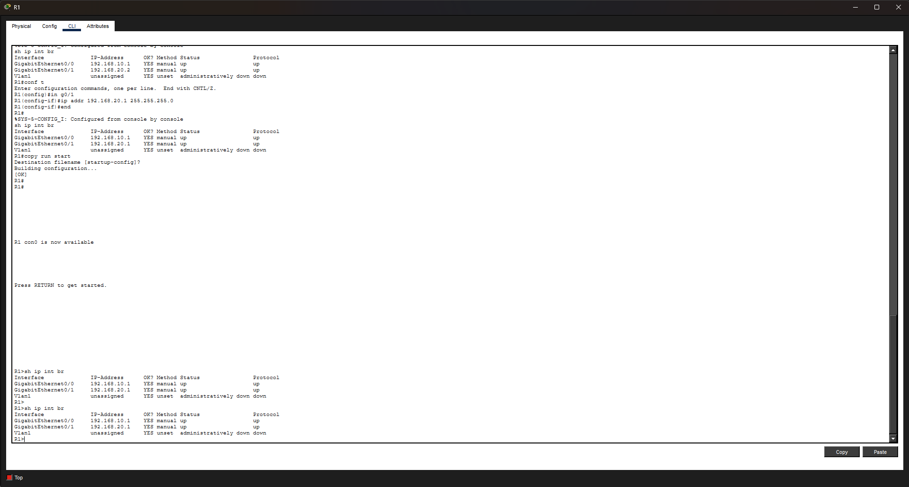

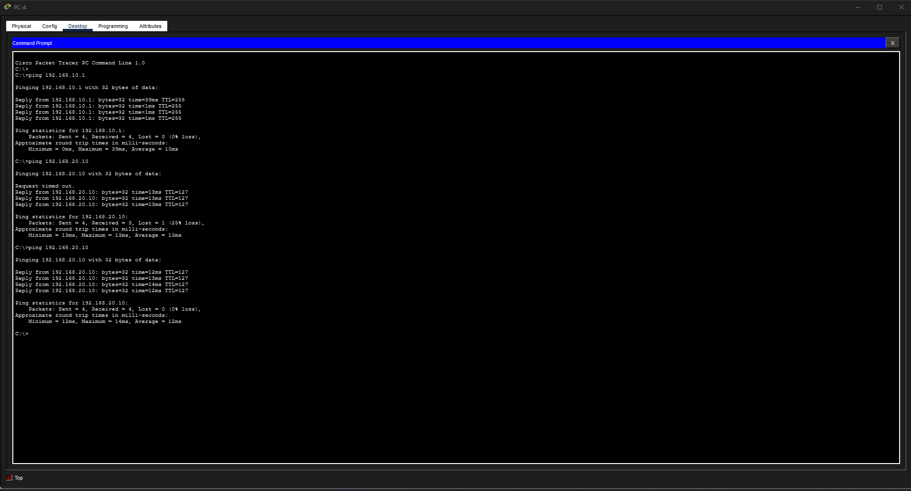

## Troubleshooting Ticket #001 — Incorrect Default Gateway

**Incident:** INC-001

**Reported Issue:** A workstation could not communicate with the company server.

**Simulated Root Cause:** PC-B's default gateway was incorrectly configured as `192.168.10.254` instead of `192.168.10.1`.

**Troubleshooting Process**
1. Reproduced the connectivity problem using `ping`.
2. Inspected the network configuration using `ipconfig /all`.
3. Identified the incorrect default gateway.
4. Restored the correct gateway address.
5. Repeated connectivity testing to verify the repair.

**Resolution:** Corrected the default gateway configuration and restored connectivity to the server.

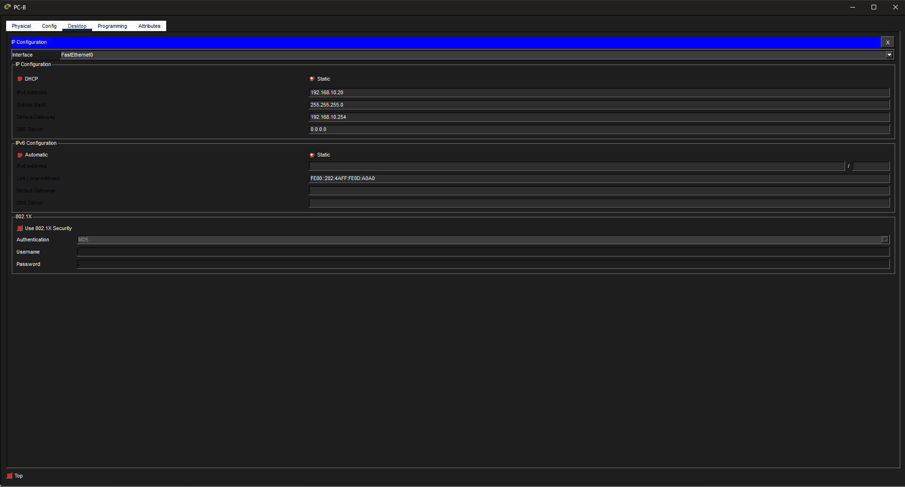

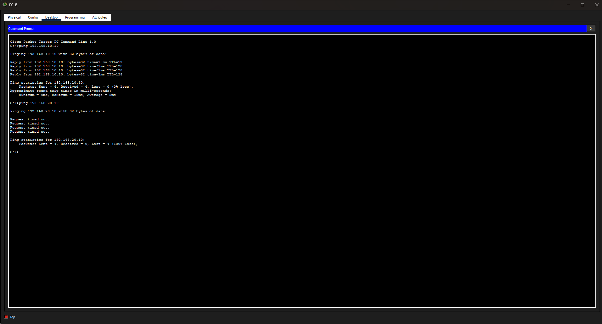

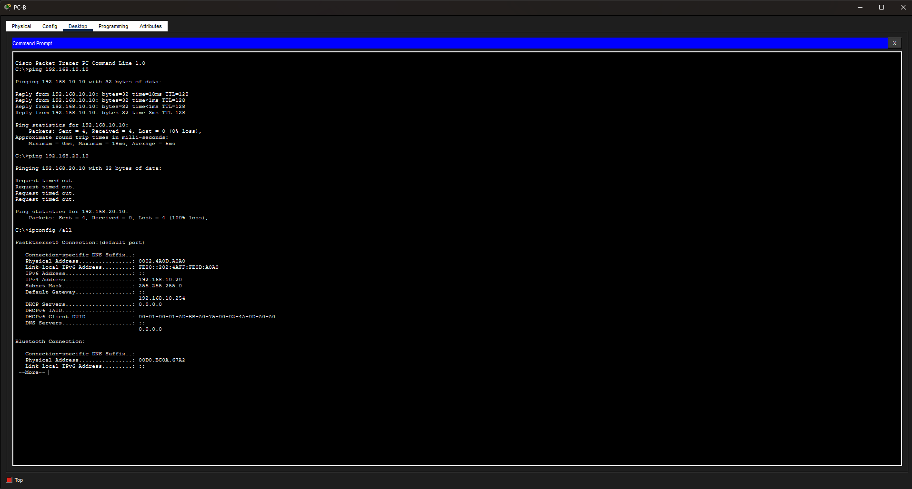

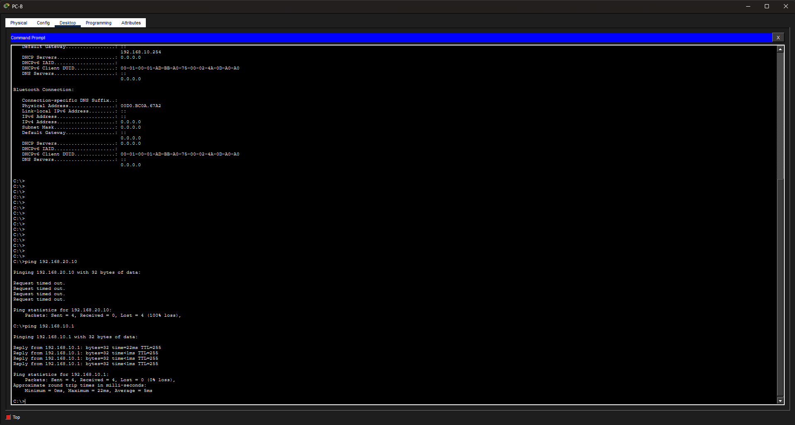

## Troubleshooting Ticket #002 — Incorrect Workstation IP Address

**Incident:** INC-002

**Reported Issue:** A workstation could not reach its default gateway or access network resources.

**Simulated Root Cause:** PC-A was configured with `192.168.30.10`, placing it outside the intended `192.168.10.0/24` office subnet.

**Troubleshooting Process**
1. Reproduced the failed gateway connection.
2. Ran `ipconfig /all` to inspect IPv4 configuration.
3. Identified the incorrect workstation IP address.
4. Restored PC-A's correct address, `192.168.10.10`.
5. Verified gateway and server communication.

**Resolution:** Restored the proper IPv4 configuration and confirmed successful connectivity with 0% packet loss.

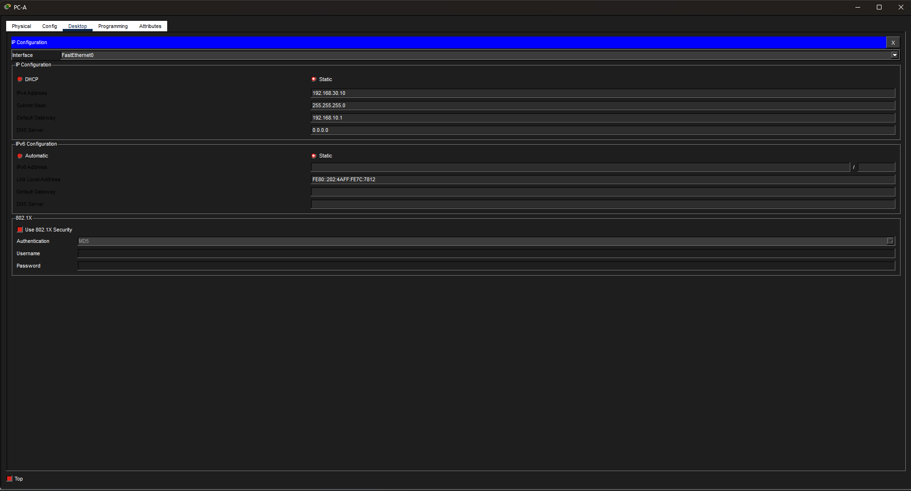

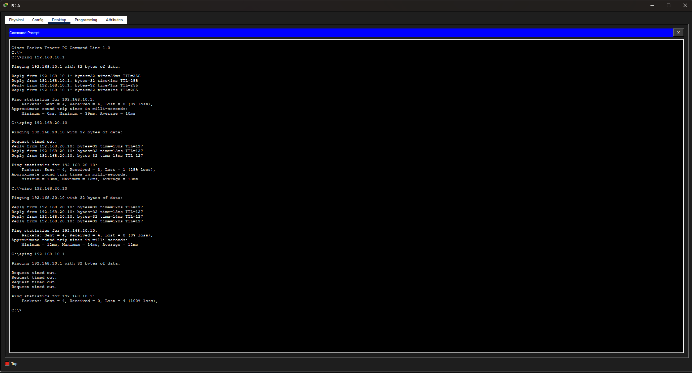

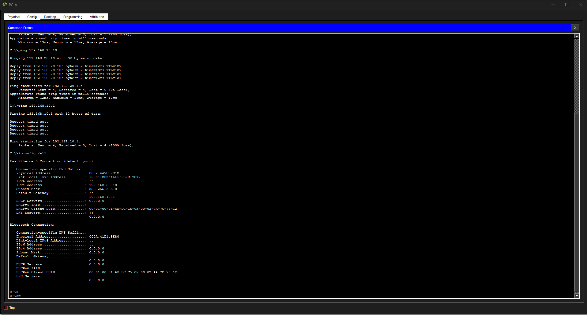

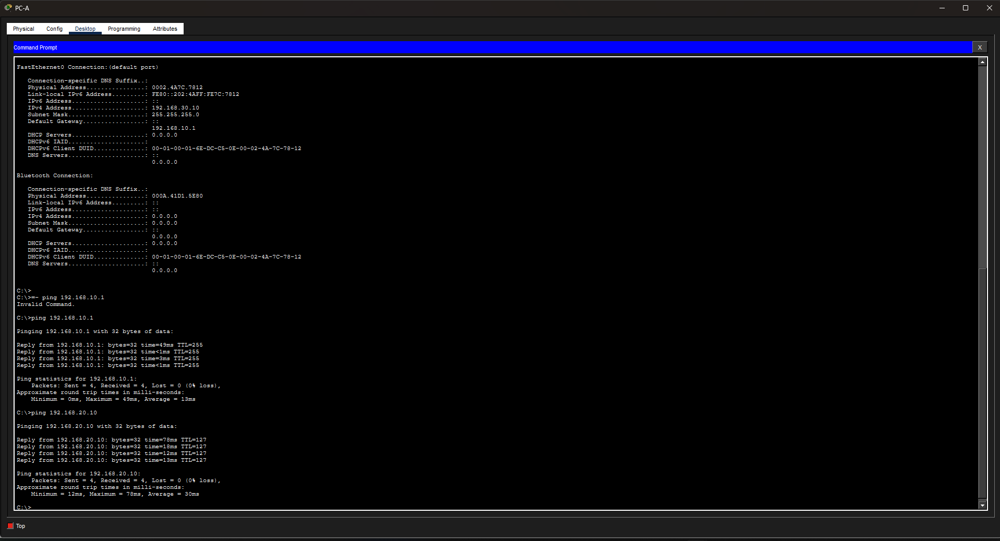

## Troubleshooting Ticket #003 — Disabled Server Network Interface

**Incident:** INC-003

**Reported Issue:** Office workstations could no longer communicate with the company server.

**Simulated Root Cause:** SRV1's FastEthernet0 network interface was administratively disabled.

**Troubleshooting Process**
1. Reproduced the server connectivity outage.
2. Confirmed 100% packet loss when pinging the server.
3. Inspected the server interface configuration.
4. Re-enabled FastEthernet0.
5. Retested connectivity from PC-A to SRV1.

**Resolution:** Restored the server's network interface and confirmed four successful ping replies with 0% packet loss.

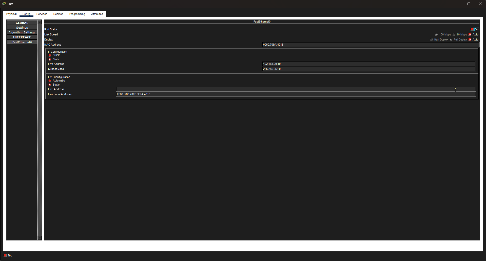

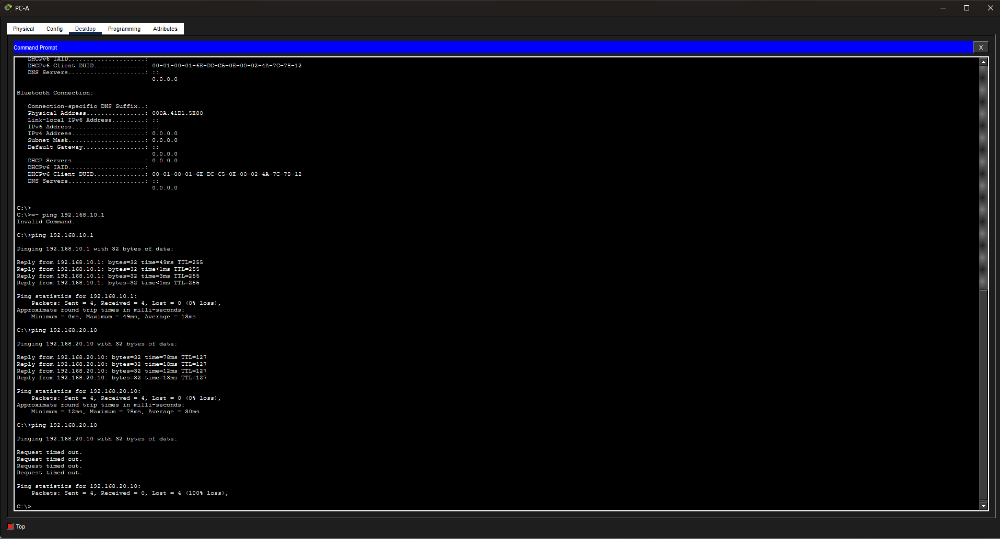

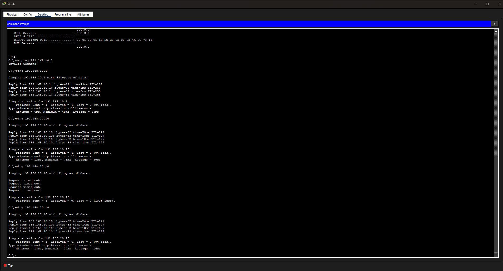

## Technical Skills Demonstrated

- Configuring IPv4 addresses, subnet masks, and default gateways
- Working with separate office and server subnets
- Verifying router interfaces and network connectivity
- Troubleshooting incorrect IP addressing
- Diagnosing default gateway misconfigurations
- Identifying disabled network interfaces
- Using command-line diagnostic tools
- Documenting simulated incidents and their resolutions
- Applying a systematic troubleshooting methodology

## Project Files

**Cisco Packet Tracer Simulation:** `Small-office-network-troubleshooting.pkt`

**Supporting Evidence:** 19 PNG screenshots documenting network configuration, connectivity testing, troubleshooting, and resolution.

## Conclusion

This lab strengthened my practical understanding of TCP/IP networking, network connectivity, and structured IT troubleshooting.

By building the network, reproducing three realistic support incidents, diagnosing the underlying problems, and verifying successful repairs, I gained additional hands-on experience relevant to IT Support, Network Operations Center (NOC), and Network Technician roles.

All troubleshooting incidents were simulated in Cisco Packet Tracer for educational and portfolio purposes.
